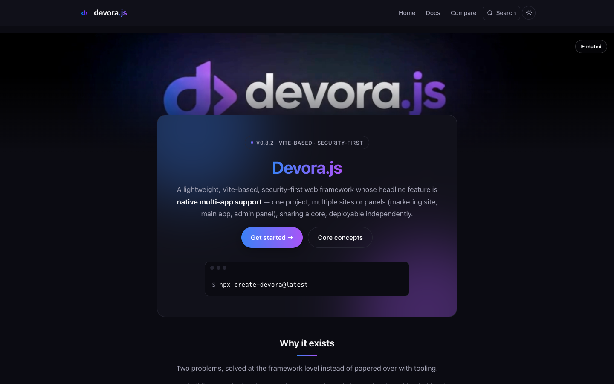

<div align="center">


# Devora.js documentation

**The documentation site for [Devora.js](https://github.com/hassanalsa3aka/devora.js), built with Devora.js itself.**
Live at **[devorajs-docs-docs.vercel.app](https://devorajs-docs-docs.vercel.app)**.

<p>
  <a href="LICENSE"></a>
  <a href="https://www.npmjs.com/package/@devorajs/core"></a>
  = 20" />
  <a href="https://discord.gg/wYFYmFxdS8"></a>
</p>



</div>

## What this is

A one-app Devora.js project that uses the **published npm packages** (`@devorajs/core` and
`@devorajs/cli` `^0.3.2`), not the framework's monorepo — so it's also a real-world check that
what's on npm works. Every page is `ssg` (pre-rendered at build time); search is a
[Pagefind](https://pagefind.app) index built after `devora build`.

The docs describe the framework as of 0.3.2: getting started, a multi-app tutorial, render modes,
pages/forms/errors, the backend and API routes, the CLI, deployment, security, upgrading, and a
comparison with other frameworks.

## Project structure

```text
devorajs-docs/
├── apps/docs/
│   ├── routes/              # one file per page (all ssg)
│   ├── app.config.ts        # CSP (Pagefind + analytics hosts), sitemap, <html lang>
│   ├── docs-layout.tsx      # docs sidebar, callouts, tags
│   ├── site-footer.tsx      # footer, search overlay, theme switch, consent banner
│   ├── site-theme.ts        # site CSS on top of the framework theme
│   ├── compare-table.tsx    # brand marks + the home page's comparison table
│   ├── compare-matrix.tsx   # status chips, filterable matrix and bar chart (/compare)
│   ├── data/                # generated data (npm downloads for /compare)
│   ├── seo.tsx              # meta(), canonical links, JSON-LD
│   ├── version.ts           # reads the installed @devorajs/core version
│   ├── nav.ts               # header links
│   └── vercel.json, netlify.toml
├── assets/                  # public folder: icons, OG image, scripts, video, Pagefind index
├── packages/backend/        # the shared-backend stub every project has (unused here)
├── scripts/
│   ├── build-docs.sh            # adapter build + Pagefind index
│   ├── fetch-npm-downloads.mjs  # refreshes apps/docs/data/npm-downloads.json
│   └── og-card.html             # source of assets/og/devorajs-og.png
├── drafts/                  # earlier drafts of the compare page, not published
└── devora.config.ts
```

## Running it

Node 20 or newer.

```bash
git clone https://github.com/hassanalsa3aka/devorajs-docs.git
cd devorajs-docs
npm install
npm run dev        # http://localhost:10000
```

```bash
npm run build      # devora build, then the Pagefind index (postbuild)
npm start          # serves the build on http://localhost:4173
```

Refresh the download numbers on `/compare` with `node scripts/fetch-npm-downloads.mjs` (it picks
the most recent full week npm has complete data for).

## Writing pages

- A new page is a file in `apps/docs/routes/` with `export const renderMode = "ssg"` and a
  `meta()` built with `pageMeta()` from `seo.tsx`. Add it to the sidebar in `docs-layout.tsx`;
  the sitemap and the search index pick it up from the build.
- The CSP allows no inline scripts and no third-party hosts except the analytics ones in
  `app.config.ts`. Icons are inline SVG.
- Write `<style dangerouslySetInnerHTML={{ __html: css }} />`, not `<style>{css}</style>`: React
  escapes text children, which silently drops any rule with quotes or `>`.
- The docs app has `auth: "none"`, and the build rejects source that calls session methods on
  `ctx`. In code samples inside a template string write `` ctx${""}.requireAuth() ``; in JSX
  text write `ctx{"."}requireAuth()`.
- Claims about the framework are checked against its source or a fresh scaffold before they go
  in, and the site says where another framework is the better choice.

## Deployment

- **Vercel:** `apps/docs/vercel.json` runs `scripts/build-docs.sh vercel`.
- **Netlify:** `apps/docs/netlify.toml` runs `scripts/build-docs.sh netlify`.

## License

[MIT](LICENSE)
